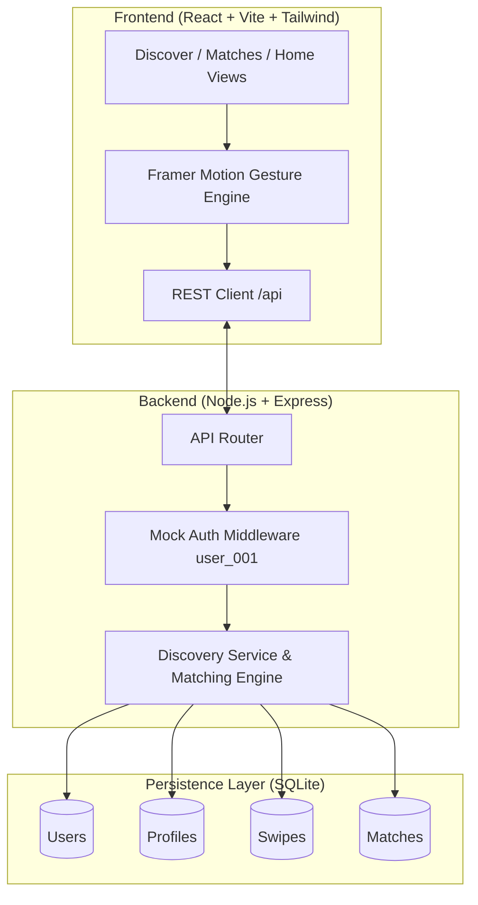
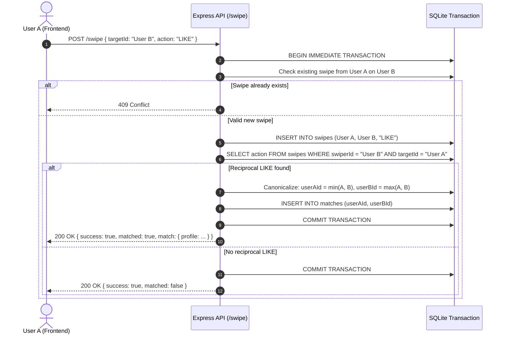

# Coy Discover – Privacy-First Dating Discovery Platform

Coy Discover is a standalone, full-stack, privacy-first dating discovery application built around mutual interest. Its foundational promise is:

> *"A user's interest in another person must never be revealed unless both users have expressed interest in each other."*

Unlike conventional dating platforms that monetize or leak one-sided interest via "who liked you" paywalls, Coy Discover enforces cryptographic and architectural privacy: pending one-sided likes are strictly server-side state, never exposed through any public API, feed payload, or frontend interface.

---

## 1. Key Features

- **Privacy-First Matching Engine**: Matches are created exclusively when both users reciprocate interest (`LIKE`). One-sided likes remain completely confidential.
- **Interactive Swipe Discovery**: Native touch, drag, and release gestures powered by Framer Motion, with dynamic rotation, directional resistance, and responsive LIKE/PASS visual indicator badges.
- **Desktop Dual Controls**: Dedicated high-contrast Like and Pass buttons alongside keyboard shortcuts (`Left Arrow` for PASS, `Right Arrow` for LIKE).
- **Match Celebration**: Instant modal celebration highlighting mutual connection, partner profiles, and privacy confirmation.
- **Authoritative SQLite Persistence**: Atomic transactions (`BEGIN IMMEDIATE TRANSACTION`), unique composite keys, and canonical pair ordering prevent duplicate records and state desynchronization.
- **Curated Profiles**: Pre-seeded database of 35 diverse candidates with verified bios, collegiate affiliations, and interest tags.
- **Responsive Adaptive Navigation**: Clean top navigation for desktop views and an accessible, fixed bottom bar for mobile screens.
- **Resilient UI States**: Skeleton loading states, graceful empty states ("Caught Up" and "No Matches"), and network error retries.
- **One-Click Demo Reset**: In-app and CLI commands to restore seeded profiles and initial state for live demonstrations.

---

## 2. System Architecture



---

## 3. Technology Stack

### Frontend
- **Framework**: React 18 with Vite
- **Styling**: Tailwind CSS
- **Animations & Gestures**: Framer Motion
- **Routing**: React Router v6
- **Icons**: Lucide React

### Backend
- **Runtime**: Node.js v24
- **Framework**: Express.js
- **Database**: SQLite (native zero-dependency `node:sqlite` DatabaseSync)
- **Utilities**: CORS, Dotenv

### Testing & QA
- **Test Runner**: Vitest
- **HTTP Testing**: Supertest

---

## 4. Folder Structure

```
coy_discover/
├── backend/
│   ├── data/
│   │   └── coy_discover.db
│   ├── src/
│   │   ├── controllers/
│   │   │   ├── feedController.js
│   │   │   ├── matchesController.js
│   │   │   └── swipeController.js
│   │   ├── db/
│   │   │   ├── database.js
│   │   │   └── seed.js
│   │   ├── middleware/
│   │   │   ├── auth.js
│   │   │   └── errorHandler.js
│   │   ├── routes/
│   │   │   └── api.js
│   │   ├── services/
│   │   │   └── discoveryService.js
│   │   ├── app.js
│   │   └── server.js
│   ├── tests/
│   │   └── api.test.js
│   ├── package.json
│   └── vitest.config.js
├── frontend/
│   ├── src/
│   │   ├── components/
│   │   │   ├── EmptyFeed.jsx
│   │   │   ├── ErrorAlert.jsx
│   │   │   ├── LoadingSkeleton.jsx
│   │   │   ├── MatchModal.jsx
│   │   │   ├── Navigation.jsx
│   │   │   ├── ProfileCard.jsx
│   │   │   └── SwipeControls.jsx
│   │   ├── pages/
│   │   │   ├── DiscoverPage.jsx
│   │   │   ├── HomePage.jsx
│   │   │   └── MatchesPage.jsx
│   │   ├── services/
│   │   │   └── api.js
│   │   ├── App.jsx
│   │   ├── index.css
│   │   └── main.jsx
│   ├── index.html
│   ├── package.json
│   ├── postcss.config.js
│   ├── tailwind.config.js
│   └── vite.config.js
├── .env.example
├── .gitignore
├── package.json
└── README.md
```

---

## 5. Database Schema

The database relies on four relational tables enforced by SQLite foreign keys and unique constraints:

### Users
- `id` (TEXT, Primary Key): Unique user identifier.
- `name` (TEXT, Not Null): Full name.
- `email` (TEXT, Not Null): Email address.
- `createdAt` (TEXT, Not Null): ISO 8601 timestamp.

### Profiles
- `id` (TEXT, Primary Key): Profile record identifier.
- `userId` (TEXT, Unique, Foreign Key -> `users.id`): Associated user.
- `name` (TEXT, Not Null): Display name.
- `age` (INTEGER, Not Null): User age.
- `photo` (TEXT, Not Null): Image URL.
- `bio` (TEXT, Not Null): Profile summary.
- `city` (TEXT, Not Null): Geographic location.
- `college` (TEXT): Academic institution.
- `interests` (TEXT, Not Null): JSON-encoded string array.

### Swipes
- `id` (TEXT, Primary Key): Unique swipe identifier.
- `swiperId` (TEXT, Not Null, Foreign Key -> `users.id`): User initiating the swipe.
- `targetId` (TEXT, Not Null, Foreign Key -> `users.id`): User being swiped on.
- `action` (TEXT, Not Null, Check `action IN ('LIKE', 'PASS')`): Action taken.
- `createdAt` (TEXT, Not Null): ISO 8601 timestamp.
- **Constraint**: `UNIQUE(swiperId, targetId)` prevents multiple swipes on the same profile.

### Matches
- `id` (TEXT, Primary Key): Match record identifier.
- `userAId` (TEXT, Not Null, Foreign Key -> `users.id`): First user in canonical order (`userAId < userBId`).
- `userBId` (TEXT, Not Null, Foreign Key -> `users.id`): Second user in canonical order.
- `createdAt` (TEXT, Not Null): ISO 8601 timestamp.
- **Constraint**: `UNIQUE(userAId, userBId)` prevents duplicate match records for any pair.

---

## 6. Privacy Design & Security

1. **Zero Exposure of Incoming Likes**: The `GET /feed` query fetches candidates excluding both self and any user already swiped on by the logged-in user. It never reads or joins incoming swipe records for candidate profiles.
2. **No Pending Likes Endpoint**: There is deliberately no endpoint that returns who liked the current user.
3. **Server-Side Matching Authority**: Clients cannot trigger match creation directly. Match creation is strictly determined on the backend inside an immediate transaction when a reciprocal `LIKE` is detected.
4. **Canonical Pair Sorting**: To eliminate race conditions where both users like each other simultaneously, match rows store `userAId` and `userBId` sorted lexicographically (`userAId < userBId`) with a database-level unique constraint.
5. **No Self-Swiping**: Swipes targeting the logged-in user's own identifier are validated and rejected server-side with HTTP 400.
6. **Immutable Swipes**: Once a user swipes LIKE or PASS on a profile, any subsequent swipe returns HTTP 409 Conflict.
7. **Safe Error Masking**: Application errors return clean, standardized JSON messages without exposing internal stack traces or raw database queries.

---

## 7. Matching Algorithm

When User A submits a swipe on User B with action `LIKE`:



---

## 8. API Documentation

### 1. GET `/feed` or `/api/feed`
Retrieves profiles eligible for discovery by the authenticated user.

- **Excludes**: The logged-in user, previously liked profiles, and previously passed profiles.
- **Headers**:
  - `x-user-id` (optional, defaults to `user_001`)

**Response (200 OK)**:
```json
{
  "profiles": [
    {
      "id": "user_002",
      "name": "Riya Sen",
      "age": 23,
      "photo": "https://images.unsplash.com/photo-1517841905240-472988babdf9?auto=format&fit=crop&w=800&q=80",
      "bio": "Architect in training. Coffee fanatic and 35mm film photographer chasing golden hour.",
      "city": "Bengaluru",
      "college": "School of Planning and Architecture",
      "interests": [
        "Architecture",
        "Photography",
        "Specialty Coffee",
        "Jazz"
      ]
    }
  ]
}
```

---

### 2. POST `/swipe` or `/api/swipe`
Records a swipe action (`LIKE` or `PASS`) on a candidate profile.

**Request Body**:
```json
{
  "targetId": "user_002",
  "action": "LIKE"
}
```

**Non-Match Response (200 OK)**:
```json
{
  "success": true,
  "matched": false
}
```

**Match Created Response (200 OK)**:
```json
{
  "success": true,
  "matched": true,
  "match": {
    "id": "match_e762c2f6-39eb-4a62-97b7-69faebadbe38",
    "createdAt": "2026-11-18T09:19:35.123Z",
    "profile": {
      "id": "user_002",
      "name": "Riya Sen",
      "age": 23,
      "photo": "https://images.unsplash.com/photo-1517841905240-472988babdf9?auto=format&fit=crop&w=800&q=80",
      "bio": "Architect in training. Coffee fanatic and 35mm film photographer chasing golden hour.",
      "city": "Bengaluru",
      "college": "School of Planning and Architecture",
      "interests": [
        "Architecture",
        "Photography",
        "Specialty Coffee",
        "Jazz"
      ]
    }
  }
}
```

---

### 3. GET `/matches` or `/api/matches`
Retrieves mutual matches belonging to the authenticated user.

**Response (200 OK)**:
```json
{
  "matches": [
    {
      "matchId": "match_e762c2f6-39eb-4a62-97b7-69faebadbe38",
      "matchedAt": "2026-11-18T09:19:35.123Z",
      "profile": {
        "id": "user_002",
        "name": "Riya Sen",
        "age": 23,
        "photo": "https://images.unsplash.com/photo-1517841905240-472988babdf9?auto=format&fit=crop&w=800&q=80",
        "bio": "Architect in training. Coffee fanatic and 35mm film photographer chasing golden hour.",
        "city": "Bengaluru",
        "college": "School of Planning and Architecture",
        "interests": [
          "Architecture",
          "Photography",
          "Specialty Coffee",
          "Jazz"
        ]
      }
    }
  ]
}
```

---

### 4. POST `/reset` or `/api/reset`
Utility endpoint for demonstration and QA resetting. Restores the database with initial profiles and seeded incoming likes for `user_001`.

**Response (200 OK)**:
```json
{
  "success": true,
  "message": "Database reset and re-seeded successfully",
  "usersCount": 36,
  "seededLikesCount": 7
}
```

---

## 9. Installation & Local Setup

### Prerequisites
- Node.js v22.5.0 or higher (v24 recommended for native `node:sqlite`)
- npm v10 or higher

### 1. Clone & Install Dependencies
From the repository root:
```bash
npm run backend:install
npm run frontend:install
```

### 2. Configure Environment
Copy `.env.example` to create `.env` if custom ports or paths are needed:
```bash
cp .env.example .env
```

### 3. Seed the Database
```bash
npm run seed
```

### 4. Start the Application
To run both backend (Port 5000) and frontend (Port 3000) concurrently:
```bash
npm run dev
```

Alternatively, run in separate terminal windows:
```bash
npm run backend
```
```bash
npm run frontend
```

Open your browser at `http://localhost:3000`.

---

## 10. Automated Testing

The backend includes automated tests covering 15 distinct functional, privacy, and architectural requirements:

1. `GET /feed` returns eligible profiles.
2. Current user (`user_001`) is excluded from feed.
3. Previously liked profiles are excluded from feed.
4. Previously passed profiles are excluded from feed.
5. `POST /swipe` LIKE saves a swipe record.
6. `POST /swipe` PASS saves a swipe record.
7. Duplicate swipes on the same candidate are rejected (409 Conflict).
8. Self-swipes are rejected (400 Bad Request).
9. One-sided LIKE does not create a match.
10. Reciprocal LIKE immediately creates a match.
11. Duplicate matches cannot be created for the same pair.
12. `GET /matches` returns mutual matches only.
13. Incoming likes are never exposed in feed or profile payloads.
14. Swipe records and feed exclusion persist across database restarts.
15. Simultaneous reciprocal likes result in exactly one match.

Execute the test suite with:
```bash
npm test
```

---

## 11. Deployment

### Production Build
1. Build the production bundle for the frontend:
```bash
npm run build
```
The compiled assets will be placed in `frontend/dist`.

2. The Express backend can serve the compiled frontend as static files or deploy alongside a reverse proxy (e.g., Nginx, Caddy, Railway, Render).

3. Set production environment variables:
```
PORT=5000
DATABASE_PATH=/var/data/coy_discover.db
```
